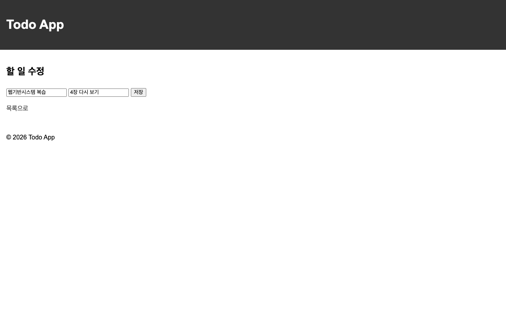
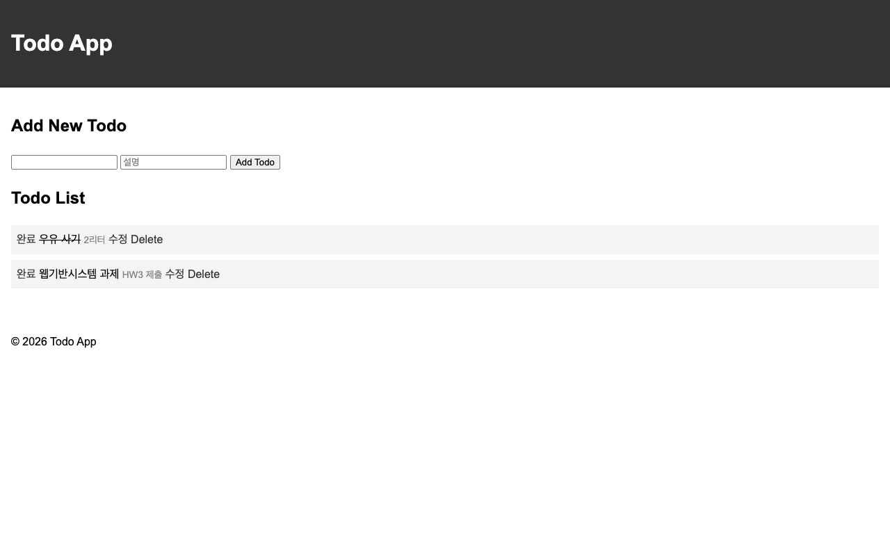

# HW3 — Todo 앱에 수정 기능 더하기

- 이름 : 배병욱
- 학번 : 21011696

Note 6의 50~54페이지를 참고했습니다. `todo_app`을 SQLite로 바꾸고 `HW3`로 복사한 뒤, 설명 칸과 수정 화면을 추가했습니다.

## 수정한 부분

1. `Todo` 모델에 `id`, `text`, `note`, `done`을 저장합니다. 앱을 켜면 `db.create_all()`로 표가 만들어집니다.
2. 추가 폼에서 할 일과 설명을 받아 저장하고, `Todo.query.all()`로 목록을 읽습니다.
3. `/toggle/<int:id>`에서 완료 상태를 바꾸고, 완료한 할 일에는 취소선을 표시합니다.
4. `/edit/<int:id>`는 GET으로 수정 화면을 보여 주고, POST로 할 일과 설명을 저장한 뒤 목록으로 돌아갑니다. 입력칸에는 현재 값이 들어 있습니다.
5. `/delete/<int:id>`에서 해당 할 일을 삭제합니다. 링크에는 `todo.id`를 사용합니다.

SQLite 파일은 `HW3/instance/todo.db`에 자동으로 생깁니다. `.gitignore`에 `instance/`를 추가해 데이터베이스 파일은 올리지 않았습니다.

## 실행 방법

저장소 맨 위에서 실행합니다.

```bash
source venv/bin/activate
pip install -r requirements.txt
cd HW3
flask --debug run
```

브라우저에서 http://127.0.0.1:5000/ 에 접속합니다.

## 동작 확인

- 할 일과 설명을 추가하면 목록에 표시됩니다.
- 완료를 누르면 취소선이 생기고, 다시 누르면 사라집니다.
- 수정 화면에 기존 값이 표시되고, 저장하면 고친 할 일과 설명이 목록에 반영됩니다.
- Delete를 누르면 해당 할 일이 사라집니다.
- 서버를 Ctrl+C로 종료한 뒤 다시 실행해도 수정한 내용과 완료 상태가 유지됩니다.

## 실행 화면

### ① 목록 화면

우유 사기는 완료한 상태이고, 두 번째 할 일과 설명은 수정 후의 값입니다.


### ② 수정 화면

수정 전의 할 일인 `웹기반시스템 복습`과 설명인 `4장 다시 보기`가 입력칸에 들어 있습니다. 저장할 때 각각 `웹기반시스템 과제`, `HW3 제출`로 고쳤습니다.



### ③ 서버를 껐다 켠 뒤의 목록

서버를 종료하고 다시 실행한 뒤 캡처했습니다. 할 일, 설명, 완료 상태가 첫 번째 목록과 같습니다.


