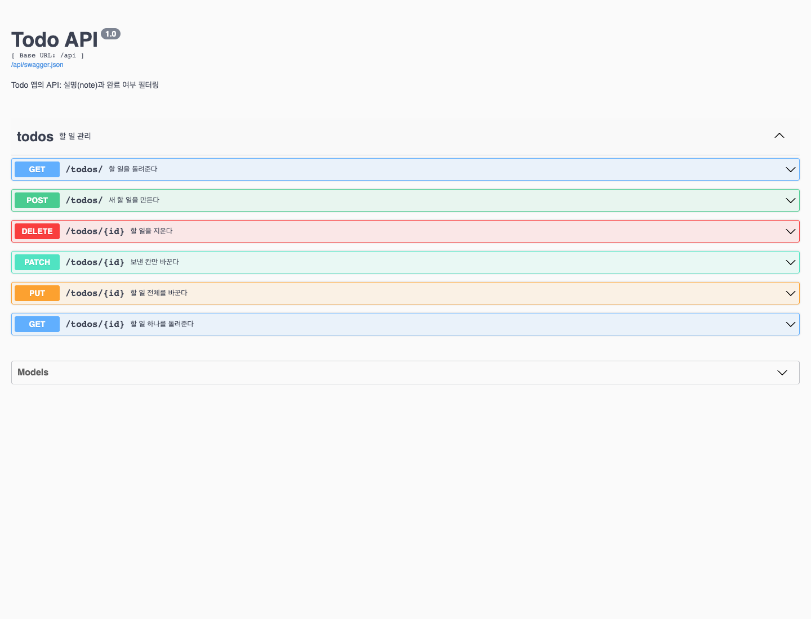
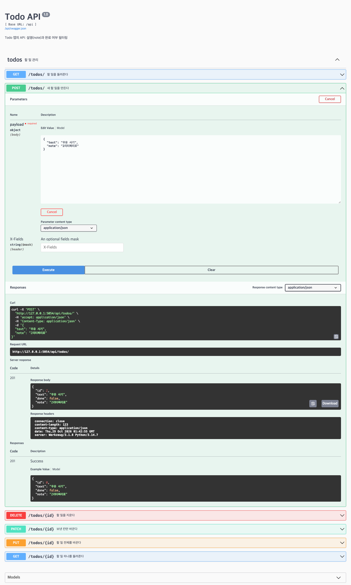
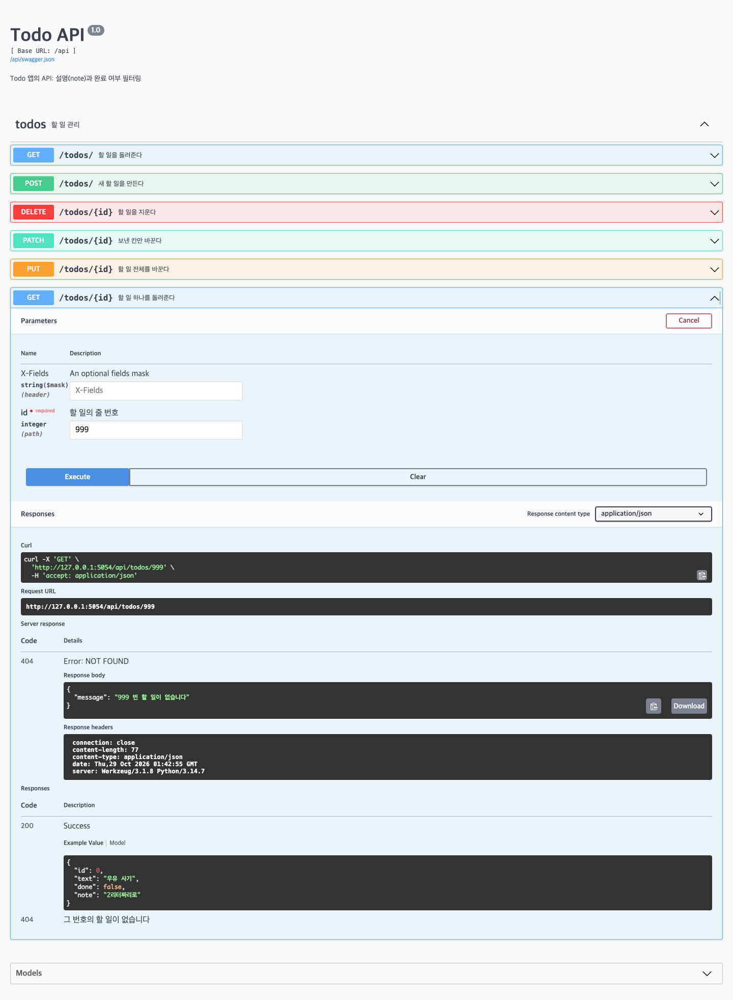

# HW4 : todo 앱에 API 더하기

## 더한 것

- 설명 칸(note)을 API로도 주고받게 했습니다. 생략하면 빈 문자열이 들어갑니다.
- `GET /api/todos/?done=true`로 완료한 것만, `?done=false`로 미완료 항목만 골라 받습니다. 생략하면 전부 반환합니다.

## 실행하는 법

저장소 루트에서 가상환경을 활성화한 뒤 HW4 폴더에서 실행합니다.

```bash
source venv/bin/activate
cd HW4
pip install -r requirements.txt
flask --debug run
```

가상환경이 없으면 저장소 루트에서 `python3 -m venv venv`로 먼저 만듭니다.

- 화면: http://127.0.0.1:5000/
- 문서: http://127.0.0.1:5000/api/docs

## 테스트

HW4 폴더에서 실행합니다.

```bash
python -m unittest
```

테스트 5개가 생성, 목록과 필터, 부분 수정, 삭제, 없는 번호의 JSON 오류를 확인합니다. 별도 메모리 DB를 사용합니다.

## 화면

캡처는 확인용 포트 5054에서 실행했습니다. 기본 실행 포트는 5000입니다.

### 1. 주소 여섯 줄이 모두 보이는 문서



### 2. note를 넣어 만들었더니 201이 온 모습



### 3. 없는 번호를 불렀더니 404가 온 모습


